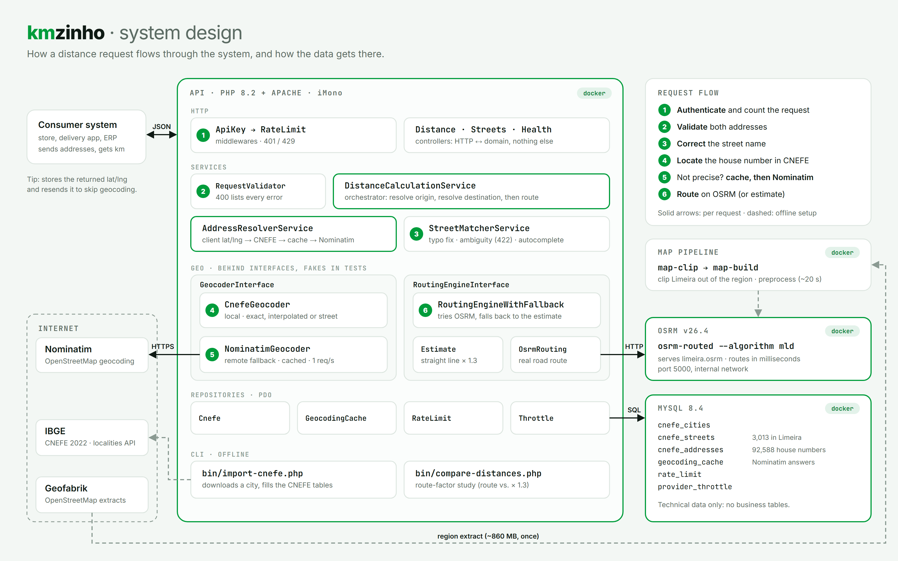

# kmzinho

[](https://github.com/FabioAugustoRodrigues/kmzinho/actions/workflows/tests.yml)

*[Read in English](en.md)*

API REST open-source que calcula a **distância real de rota** entre dois endereços
brasileiros, construída sobre o framework PHP [iMono](https://github.com/FabioAugustoRodrigues/iMono).
Projeto de estudos, com piloto em Limeira/SP.

A API não conhece preço, cliente nem pedido: ela informa a distância, o tempo de viagem
e a precisão com que cada endereço foi localizado. Regra de negócio é responsabilidade
de quem consome.

## Como funciona

```
endereço digitado -> correção do nome da rua (base de ruas do CNEFE)
                  -> número da casa -> coordenadas (CNEFE; Nominatim como reserva)
                  -> rota pelas ruas no OSRM -> distância em km + tempo de viagem
                     (se o OSRM cair, usa a estimativa por linha reta)
```

- **CNEFE** (Cadastro Nacional de Endereços para Fins Estatísticos) é a lista de
  endereços do Censo 2022, publicada pelo IBGE com a coordenada coletada em campo para
  cada domicílio. Só Limeira tem 92.588 números de casa em 3.013 ruas. Números que
  faltam são interpolados entre os vizinhos do mesmo lado da rua.
- **Nominatim** geocodifica com dados do OpenStreetMap. No Brasil, poucos números de
  casa estão mapeados, então muitas vezes ele só acha a rua: é a reserva para o que o
  CNEFE não tem.
- **OSRM** (Open Source Routing Machine) calcula a rota mais rápida sobre o grafo de
  ruas do OpenStreetMap, em milissegundos, a partir de um mapa pré-processado uma vez.

## Arquitetura (system design)



Três containers Docker e três fontes de dados externas:

| Peça | Papel |
|---|---|
| **api** (PHP 8.2 + Apache, iMono) | Código em camadas: HTTP (autenticação, rate limit, controllers) → serviços (orquestração, resolução de endereço, correção de ruas) → integrações geográficas atrás de interfaces → repositórios (PDO) |
| **mysql** (MySQL 8.4) | Só dados técnicos: a base de endereços do CNEFE, o cache do Nominatim, os contadores de rate limit e o controle de ritmo dos provedores |
| **osrm** (OSRM v26.4) | Serve o grafo de ruas pré-processado da cidade piloto; calcula rotas em milissegundos |
| **Nominatim** (internet) | Geocodificação de reserva, chamada só quando o CNEFE não localiza o endereço com precisão; com cache e no máximo 1 requisição por segundo |
| **IBGE** (internet) | Fonte dos arquivos do CNEFE, baixados pelo `bin/import-cnefe.php` (offline) |
| **Geofabrik** (internet) | Fonte do mapa do OpenStreetMap que o `map-clip` e o `map-build` transformam no mapa de rotas (offline) |

Os passos numerados seguem um `POST /api/v1/distance`. As setas contínuas
acontecem em toda requisição; as tracejadas são preparação feita uma vez. O
diagrama é gerado a partir de [design/system-design.html](design/system-design.html);
veja [design/README.md](design/README.md) para editar e gerar de novo.

## Resultados

Um atalho comum para calcular frete é "distância em linha reta × 1,3". Medido em 299
pares aleatórios de endereços reais de Limeira, com rota de carro
(`bin/compare-distances.php SP Limeira 300 42`):

| | mín | mediana | média | p90 | máx |
|---|---|---|---|---|---|
| rota / linha reta | 1,09 | 1,46 | 1,51 | 1,81 | 3,50 |

- A estimativa ×1,3 erra **11,5% na mediana** e 28% no percentil 90.
- Só **43,5%** dos pares ficam a até 10% da rota real.
- No pior caso, a estimativa fica **63% abaixo** da rota. Rios, rodovias e ruas sem
  saída fazem algumas rotas chegarem a 3,5× a linha reta; nenhum fator fixo absorve isso.
- O melhor fator único para a cidade seria 1,49, e ainda assim erraria os casos
  extremos. Daí o roteamento real.

A geocodificação pesa tanto quanto: para um endereço, o Nominatim devolveu "o meio da
rua", a 680 m do número de casa que o CNEFE conhece.

## API

Referência completa (em inglês): [API.md](API.md).

| Endpoint | |
|---|---|
| `POST /api/v1/distance` | distância de rota e tempo de viagem entre dois endereços |
| `GET /api/v1/streets/suggestions` | autocomplete de nome de rua pela base local |
| `GET /api/v1/health` | estado do banco e do motor de rotas |

## Rodando localmente

Requisitos: PHP 8.1+ com `curl`, `pdo_mysql`, `mbstring` e `zip`, Composer e Docker.

```bash
composer install
cp .env.example .env
docker compose up -d --build
curl http://localhost:8080/api/v1/health
```

A API responde em `http://localhost:8080`; o MySQL fica na porta `3307` do host.

O schema só é aplicado automaticamente quando o volume do MySQL é criado. Depois de
mudanças no schema, aplique num volume existente com:

```bash
docker compose exec -T mysql mysql -ugeo_frete -pgeo_frete geo_frete < database/schema.sql
```

> No Windows, o compartilhamento de arquivos do Docker deixa cada requisição ~0,4 s
> mais lenta. Para iterar rápido, rode `php -S localhost:8090 index.php` usando os
> mesmos containers.

### Base de endereços (CNEFE)

Importe cada cidade atendida (rodar de novo substitui a importação anterior):

```bash
docker compose exec api php bin/import-cnefe.php SP Limeira
```

O script descobre o código IBGE do município, baixa o arquivo do CNEFE (alguns MB,
guardados em `data/cnefe/`), junta os apartamentos de um mesmo número e carrega ruas e
números. Limeira leva cerca de 10 segundos. Sem importação a cidade continua
funcionando, só pelo Nominatim e sem correção de nomes de rua.

> Rodar com o PHP do host (`php bin/import-cnefe.php ...`) exige certificados HTTPS
> configurados; o XAMPP vem sem eles (configure `curl.cainfo` no `php.ini`).

### Mapa de rotas (OSRM)

Sem mapa, o container `osrm` encerra e a API responde com estimativas por linha reta
(`"method": "estimate"`). Para montar o mapa da cidade piloto:

```bash
docker compose run --rm map-clip    # baixa o mapa do Sudeste (~860 MB) e recorta Limeira
docker compose run --rm map-build   # pré-processamento do OSRM (~20 s)
docker compose restart osrm
```

Nas próximas vezes o download só acontece se o Geofabrik tiver publicado um mapa
novo, então repetir os três comandos (por exemplo, todo mês) atualiza o mapa. Outra
cidade: defina `OSRM_REGION_URL`, `OSRM_BBOX` (`lng_min,lat_min,lng_max,lat_max`) e
`OSRM_MAP_NAME` nas duas etapas. Os arquivos ficam em `osrm-data/` (fora do Git); o
download regional em `osrm-data/source/` pode ser apagado para liberar espaço.

### Reproduzindo os resultados

Com a cidade importada e o mapa montado:

```bash
docker compose exec api php bin/compare-distances.php SP Limeira 300 42
```

Argumentos: estado, cidade, quantidade de pares e semente aleatória (mesma semente,
mesmos pares).

## Configuração

| Variável | Padrão | Descrição |
|---|---|---|
| `APP_ENV` | `production` | `production`, `development` ou `testing` (no testing, os provedores viram falsos) |
| `DB_HOST`, `DB_PORT`, `DB_USER`, `DB_PASS`, `DB_NAME` | `127.0.0.1`, `3306`, `root`, vazio, `geo_frete` | conexão com o MySQL |
| `API_KEYS` | vazio | chaves aceitas, separadas por vírgula; vazio desliga a autenticação |
| `RATE_LIMIT_PER_MINUTE` | `120` | requisições por minuto por chave (ou por IP, sem autenticação) |
| `APP_USER_AGENT` | `kmzinho/0.1` | identifica a aplicação para os serviços do OpenStreetMap (exigido pela política de uso) |
| `APP_CONTACT` | vazio | contato opcional adicionado ao User-Agent; recomendado, mas nunca um contato falso |
| `NOMINATIM_URL` | `https://nominatim.openstreetmap.org` | geocodificação de reserva |
| `HTTP_TIMEOUT` | `8` | segundos até uma chamada externa desistir |
| `IBGE_LOCALITIES_URL` | API de localidades do IBGE | códigos de município, para a importação do CNEFE |
| `CNEFE_BASE_URL` | FTP do IBGE, CNEFE 2022 por município | de onde os arquivos do CNEFE são baixados |
| `CNEFE_DATA_DIR` | `data/cnefe` | cache dos downloads do CNEFE |
| `OSRM_URL` | `http://127.0.0.1:5000` | motor de rotas (o Compose define `http://osrm:5000` para o serviço api) |
| `OSRM_TIMEOUT` | `3` | segundos de espera pelo OSRM antes de usar a estimativa |
| `SNAP_WARNING_KM` | `0.3` | quanto um ponto pode ser deslocado até a rua antes de pedir confirmação |
| `OSRM_MAP_NAME` | `limeira` | nome do mapa montado pelo `map-clip`/`map-build` |
| `GEOCODING_CACHE_DAYS` | `180` | dias que uma resposta do Nominatim fica em cache |
| `ROUTE_FACTOR` | `1.3` | multiplicador da linha reta, usado só quando o OSRM não responde |

## Estrutura do projeto

```
app/http/            controllers e middlewares (chave de API, rate limit)
app/domain/service/  orquestração: resolução de endereço, correção de ruas, distância
app/domain/geo/      integrações atrás de interfaces: CNEFE, Nominatim, OSRM
app/domain/model/    objetos de valor imutáveis
app/tests/           suítes Unit, Integration (MySQL) e Feature (requisição completa)
bin/                 importação do CNEFE e o estudo do fator de rota
docker/              imagem PHP e o pipeline do mapa do OSRM
```

Todo provedor externo fica atrás de uma interface (`GeocoderInterface`,
`RoutingEngineInterface`) e é trocado por um falso nos testes, então a suíte nunca
acessa a internet.

## Testes

```bash
vendor/bin/phpunit
```

Os testes unitários não precisam de nada. Os de integração e de feature usam o banco
`geo_frete_test` criado pelo Docker Compose, e são pulados quando ele não está
acessível. O CI roda a suíte inteira no PHP 8.1, 8.2 e 8.3 com MySQL 8.4.

## Dados e licenças

- Endereços: CNEFE, Censo Demográfico 2022, © [IBGE](https://www.ibge.gov.br/).
- Dados de mapa © contribuidores do [OpenStreetMap](https://www.openstreetmap.org/copyright),
  sob a Open Database License (ODbL), baixados do [Geofabrik](https://download.geofabrik.de/).

Código: [MIT](../LICENSE).
